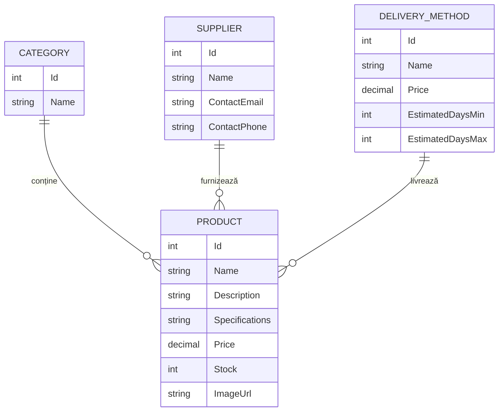
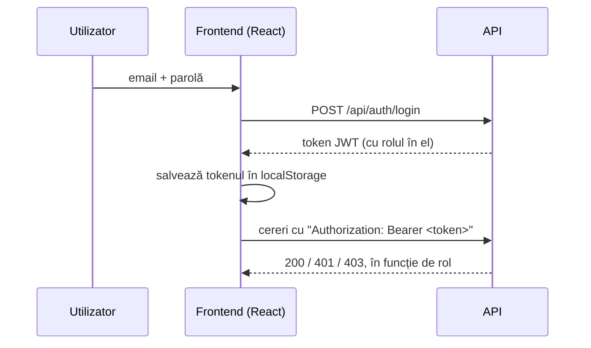

# 🎮 LagStore

**LagStore** este un magazin online de periferice gaming (mouse-uri, tastaturi, căști, monitoare, scaune și altele), realizat pentru materia **Comerț Electronic**.

Documentul descrie ce am construit până acum:

- **Raportarea I:** catalogul de produse, autentificarea și împărțirea pe roluri.
- **Raportarea II:** favorite, coș, comenzi și administrarea completă a catalogului.
- **După Raportarea II:** poze pentru produse și un design nou, monocrom.

---

## Cum pornești proiectul

Ai nevoie de **.NET 10 SDK**, **Node.js** și **SQL Server LocalDB** (vine cu Visual Studio).

**1. Secretele** (o singură dată, vezi [Securitate și configurare](#securitate-și-configurare)):

```bash
cd backend
dotnet user-secrets set "Jwt:Key" "<o cheie lungă și aleatorie, minim 32 de caractere>"
dotnet user-secrets set "SeedAdmin:Password" "<parola adminului>"
```

**2. Baza de date** (prima dată și după fiecare migrare nouă):

```bash
cd backend
dotnet ef database update
```

**3. Dependențele** (o singură dată):

```bash
npm install
npm --prefix frontend install
```

**4. Pornirea**, din folderul principal. Comanda pornește în același timp backend-ul și frontend-ul:

```bash
npm run dev
```

| Ce | Unde |
|---|---|
| Magazinul (frontend) | http://localhost:5173 |
| API-ul | https://localhost:7209/api |
| Swagger | https://localhost:7209/swagger |

La prima pornire, browserul poate refuza certificatul HTTPS local al API-ului. Deschide o dată https://localhost:7209/swagger și acceptă certificatul.

**5. Date de test** (opțional, cu API-ul pornit). Detalii în [Date de test](#date-de-test).

```powershell
$env:NODE_TLS_REJECT_UNAUTHORIZED=0; $env:ADMIN_PASSWORD="<parola adminului>"; node scripts/seed.mjs
```

---

## Ce cerea Raportarea I și cum am rezolvat

| Cerință | Ce am făcut |
|---|---|
| Două roluri: admin și utilizator | Rolurile **Admin** și **Client**, create automat la pornirea aplicației |
| Autentificare ca admin și ca client | Login și înregistrare cu token **JWT**. Contul de admin se creează automat, iar orice cont nou primește rolul Client |
| Adăugare, editare, ștergere de produse | Pagina **Administrare produse**, disponibilă doar adminului, cu tabel, formular și confirmare la ștergere |
| Produsul are nume, descriere, specificații, preț, stoc, furnizor, livrare, categorie | Entitatea `Product`, legată de `Category`, `Supplier` și `DeliveryMethod` |
| Răsfoire produse și categorii | Pagina principală cu filtrare pe categorii, căutare după nume și o pagină de detalii pentru fiecare produs |

---

## Tehnologii folosite

| Parte | Tehnologie |
|---|---|
| Backend | ASP.NET Core Web API (.NET 10) |
| Bază de date | SQL Server LocalDB, prin Entity Framework Core (code-first, cu migrări) |
| Autentificare | ASP.NET Core Identity + JWT Bearer |
| Frontend | React 19 + TypeScript, construit cu Vite |
| Stilizare | CSS simplu, cu variabile (design tokens) într-un singur fișier |
| Comunicare | Axios, cu interceptori pentru token |
| Documentare API | Swagger (`/swagger`) |

---

## Structura proiectului

```
LagStore/
├── backend/              API-ul ASP.NET Core
│   ├── Models/           Entitățile din baza de date
│   ├── DTOs/             Obiectele trimise și primite prin API
│   ├── Controllers/      Endpoint-urile REST
│   ├── Services/         Generarea tokenului JWT și salvarea pozelor
│   ├── Data/             AppDbContext (EF Core + Identity)
│   ├── Migrations/       Istoricul schemei bazei de date
│   └── wwwroot/uploads/  Pozele produselor (create la rulare, nu sunt în repository)
├── frontend/             Aplicația React
│   └── src/
│       ├── api/          Clientul Axios și mesajele de eroare
│       ├── context/      Starea de autentificare (AuthContext) și de cumpărare (ShopContext)
│       ├── components/   Header, footer, card de produs, iconițe, skeleton și altele
│       ├── pages/        Paginile aplicației
│       ├── styles/       tokens.css: culorile, fonturile, spațierile
│       ├── types/        Tipurile TypeScript
│       └── utils/        Formatarea prețurilor și a datelor
├── scripts/
│   └── seed.mjs          Populează catalogul cu date de test
└── package.json          `npm run dev` pornește backend-ul și frontend-ul împreună
```

---

## Modelul de date



- Fiecare produs aparține **unei** categorii, **unui** furnizor și **unei** metode de livrare.
- `ImageUrl` e opțional: produsele fără poză au un placeholder cu numele scris mare.
- Prețurile sunt stocate ca `decimal(18,2)`, ca să nu apară erori de rotunjire.
- Utilizatorii sunt gestionați de **ASP.NET Core Identity** (`ApplicationUser`, extins cu `FullName`), în aceeași bază de date.
- Tabelele pentru favorite, coș și comenzi sunt descrise la [Raportarea II](#raportarea-ii-favorite-coș-comenzi).

---

## API-ul

Toate rutele încep cu `/api`.

### Catalog

| Resursă | Citire (oricine) | Scriere (doar Admin) |
|---|---|---|
| `/products` | `GET` listă, `GET /{id}` | `POST`, `PUT /{id}`, `DELETE /{id}`, `POST /{id}/image`, `DELETE /{id}/image` |
| `/categories` | `GET` listă, `GET /{id}` | `POST`, `PUT /{id}`, `DELETE /{id}` |
| `/suppliers` | `GET` listă, `GET /{id}` | `POST`, `PUT /{id}`, `DELETE /{id}` |
| `/deliverymethods` | `GET` listă, `GET /{id}` | `POST`, `PUT /{id}`, `DELETE /{id}` |

Lista de produse acceptă filtre opționale: `GET /api/products?categoryId=3&search=logitech`.

### Autentificare

| Rută | Ce face |
|---|---|
| `POST /auth/register` | Creează un cont nou, cu rolul **Client**, și întoarce un token |
| `POST /auth/login` | Verifică emailul și parola și întoarce un token |

### Reguli pe care le respectă API-ul

- **DTO-uri peste tot.** Controllerele nu expun entitățile direct. DTO-urile de scriere nu conțin `Id`, deci clientul nu poate alege singur id-ul.
- **Validare.** Numele e obligatoriu, prețul trebuie să fie pozitiv, stocul nu poate fi negativ. La cereri invalide API-ul răspunde cu `400`.
- **Referințe verificate.** Un produs nu poate fi salvat cu o categorie, un furnizor sau o metodă de livrare care nu există (răspuns `400`).
- **Fără ștergeri accidentale.** O categorie, un furnizor sau o metodă de livrare folosite de produse nu pot fi șterse (răspuns `409 Conflict`).
- **Coduri HTTP corecte:** `201` la creare, `204` la editare și ștergere, `404` când resursa nu există, `401` fără autentificare, `403` fără drepturi.

---

## Autentificare și roluri



- **Rolul nu vine niciodată din request.** Serverul atribuie rolul `Client` la înregistrare, deci nimeni nu își poate face singur cont de admin.
- **Contul de admin** (`admin@lagstore.ro`) e creat automat la prima pornire, dacă nu există deja.
- **Tokenul expiră după 30 de minute.** După expirare, frontend-ul șterge sesiunea și te trimite la login.
- Tokenul conține id-ul, emailul, numele și rolul utilizatorului, semnate cu HMAC-SHA256.

---

## Frontend-ul

| Pagină | Rută | Cine are acces |
|---|---|---|
| Catalog produse | `/` | Oricine |
| Detalii produs | `/products/:id` | Oricine |
| Autentificare | `/login` | Oricine |
| Înregistrare | `/register` | Oricine |
| Favorite | `/wishlist` | Utilizator logat |
| Coș | `/cart` | Utilizator logat |
| Finalizare comandă | `/checkout` | Utilizator logat |
| Comenzile mele | `/orders` | Utilizator logat |
| Detalii comandă | `/orders/:id` | Utilizator logat (doar comenzile proprii); adminul le vede pe toate |
| Administrare produse | `/admin/products` | Doar Admin |
| Administrare categorii | `/admin/categories` | Doar Admin |
| Administrare furnizori | `/admin/suppliers` | Doar Admin |
| Administrare metode de livrare | `/admin/delivery-methods` | Doar Admin |
| Administrare comenzi | `/admin/orders` | Doar Admin |

Pe scurt, ce face fiecare parte:

- **Catalogul** afișează produsele în carduri, cu poza sau un placeholder cu numele. Le poți filtra cu chip-uri de categorie și căuta după nume; căutarea pornește la 400 ms după ce te oprești din tastat.
- **Pagina de detalii** arată poza, descrierea, specificațiile tehnice, furnizorul, metoda de livrare (cost și număr de zile) și stocul. De aici alegi cantitatea și adaugi în coș sau la favorite.
- **Pagina de administrare a produselor** are un tabel cu miniaturi și un formular pentru adăugare și editare. Categoria, furnizorul și metoda de livrare se aleg din dropdown-uri, poza se alege din calculator, iar ștergerea cere confirmare.
- **`ProtectedRoute`** blochează paginile pentru cine nu are voie: vizitatorii sunt trimiși la login, clienții nu pot intra în administrare.
- **Header-ul** arată favoritele și coșul cu numărul de produse, un meniu de cont și, doar pentru admin, meniul de administrare. Pe telefon, linkurile se mută într-un meniu hamburger.
- **Interceptorii Axios** atașează automat tokenul la fiecare cerere și deconectează utilizatorul când tokenul nu mai e valid.
- Formularele sunt validate și în browser, înainte de trimitere, iar mesajele de eroare sunt în română.

---

## Date de test

Scriptul [`scripts/seed.mjs`](scripts/seed.mjs) populează catalogul **prin API**, autentificat ca admin. Trece astfel prin aceleași validări ca orice alt client al API-ului. Scriptul adaugă:

- **8 categorii:** mouse-uri, tastaturi, căști, monitoare, mousepad-uri, scaune gaming, controllere, microfoane și webcam-uri
- **8 furnizori:** Logitech, Razer, SteelSeries, Corsair, HyperX, ASUS ROG, Samsung, Arozzi
- **5 metode de livrare:** de la ridicare gratuită din magazin până la livrare voluminoasă
- **46 de produse**, fiecare cu descriere și specificații reale, fără poze

Poți rula scriptul de mai multe ori fără probleme: ce există deja e sărit. Parola adminului se dă prin variabila `ADMIN_PASSWORD`, iar adresa API-ului prin `API_URL` (implicit `https://localhost:7209/api`).

---

## Raportarea II: favorite, coș, comenzi

| Cerință | Ce am făcut |
|---|---|
| Flow de administrare produse | Pe lângă produse, adminul gestionează acum din interfață **categoriile, furnizorii și metodele de livrare** (tabel, adăugare, editare, ștergere cu confirmare), plus **comenzile** (listă filtrabilă și schimbarea stării) |
| Wishlist | Buton inimă pe fiecare produs și pagina **Favorite** (`/wishlist`) |
| Flow de cumpărare | **Coș** salvat în baza de date (`/cart`) și **checkout** (`/checkout`) cu date de livrare, alegerea metodei de livrare și plata la livrare (ramburs) |
| Istoric comenzi | Pagina **Comenzile mele** (`/orders`), cu eticheta stării, și pagina de detalii/confirmare (`/orders/:id`) |

**Tabele noi:** `WishlistItems`, `CartItems`, `Orders`, `OrderItems` (migrarea `AddWishlistCartOrders`). Toate sunt legate de utilizator, iar endpoint-urile lor cer autentificare.

**Endpoint-uri noi:**

| Rută | Ce face |
|---|---|
| `GET/POST/DELETE /api/wishlist[/{productId}]` | Listează, adaugă (fără duplicate) și scoate favorite |
| `GET/POST/DELETE /api/cart`, `PUT/DELETE /api/cart/{productId}` | Coșul: listare cu totaluri, adăugare, modificare cantitate, ștergere linie, golire |
| `POST /api/orders` | Plasează comanda din coș |
| `GET /api/orders`, `GET /api/orders/{id}` | Comenzile proprii (adminul le poate vedea pe toate) |
| `GET /api/orders/all`, `PUT /api/orders/{id}/status` | Doar admin: toate comenzile și schimbarea stării |

**Reguli importante:**

- **Plasarea comenzii e atomică.** Într-o singură tranzacție, serverul verifică stocul fiecărui produs, îl scade, creează comanda și golește coșul. Dacă un produs nu mai are stoc suficient, nu se salvează nimic, iar clientul vede ce produs e problema.
- **Prețurile vin doar din baza de date.** Clientul trimite doar ce produse vrea, cantitatea, datele de livrare și metoda aleasă. Subtotalul, costul livrării și totalul le calculează serverul.
- **Comenzile păstrează un „snapshot”.** Numele și prețul produselor, plus metoda de livrare, se copiază în comandă. Istoricul rămâne corect chiar dacă un produs e scumpit sau șters din catalog.
- **Stările unei comenzi:** Plasată, În procesare, Expediată, Livrată sau Anulată. Adminul poate alege orice stare; doar o comandă anulată nu mai poate fi modificată. La anulare, produsele se întorc în stoc.
- **Cantitatea din coș nu poate depăși stocul.** Butoanele de coș sunt dezactivate pentru produsele epuizate.
- **Nu se colectează date de card.** Singura metodă de plată este rambursul, simulat.

---

## Poze pentru produse

Adminul poate pune câte o poză la fiecare produs, din formularul de adăugare sau editare.

- **Unde ajung:** în `backend/wwwroot/uploads/products/`, servite de API la adresa `/uploads/products/...`. Folderul e trecut în `.gitignore`, deci pozele nu ajung pe GitHub.
- **Ce se acceptă:** JPG, PNG sau WEBP, maxim 5 MB. Serverul verifică tipul după conținutul fișierului, nu după nume, și îi dă un nume nou, aleatoriu.
- **Curățenie automată:** când schimbi poza sau ștergi produsul, fișierul vechi e șters de pe disc.
- **Migrare:** `AddProductImage` adaugă coloana `ImageUrl` în tabelul `Products`.

| Rută | Ce face |
|---|---|
| `POST /api/products/{id}/image` | Doar admin: încarcă poza (`multipart/form-data`, câmpul `file`) și înlocuiește poza veche |
| `DELETE /api/products/{id}/image` | Doar admin: scoate poza produsului |

---

## Design

Interfața folosește un stil **monocrom, „editorial”**: alb, negru și gri, tipografie mare (fontul **Manrope**), contururi fine în loc de umbre și butoane rotunjite. Culoarea vine doar din pozele produselor; singura excepție e confirmarea verde a unei comenzi plasate.

- Toate culorile, mărimile, spațierile și duratele animațiilor sunt variabile CSS în [`frontend/src/styles/tokens.css`](frontend/src/styles/tokens.css). Componentele nu au valori scrise direct.
- În timpul încărcării se afișează **skeleton-uri** (blocuri gri cu forma conținutului), iar listele goale au un mesaj și un buton cu ce poți face mai departe.
- Iconițele sunt SVG-uri simple ([`Icon.tsx`](frontend/src/components/Icon.tsx)), nu emoji.
- Layout-ul funcționează și pe telefon: header cu meniu hamburger, catalog pe două coloane, tabelele din coș și comenzi devin rânduri.

---

## Securitate și configurare

Cheia de semnare JWT și parola contului de admin **nu sunt salvate în repository**. Pe mediul de dezvoltare stau în **.NET User Secrets**, un fișier local din profilul fiecărui utilizator, în afara proiectului:

```bash
cd backend
dotnet user-secrets set "Jwt:Key" "<o cheie lungă și aleatorie, minim 32 de caractere>"
dotnet user-secrets set "SeedAdmin:Password" "<parola adminului>"
```

Dacă una dintre ele lipsește, aplicația se oprește la pornire cu un mesaj care spune exact ce trebuie setat. În `appsettings.json` rămân doar setările care nu sunt secrete: emitentul și audiența tokenului, durata de expirare, emailul adminului și conexiunea la baza de date.
