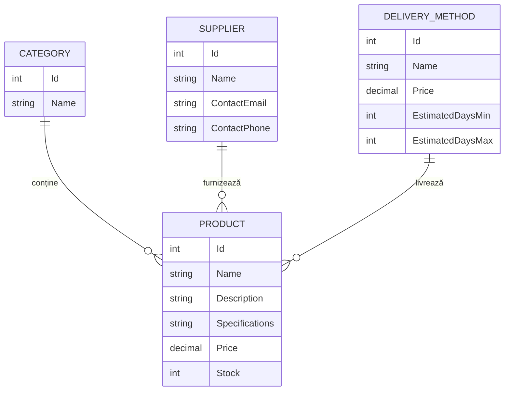
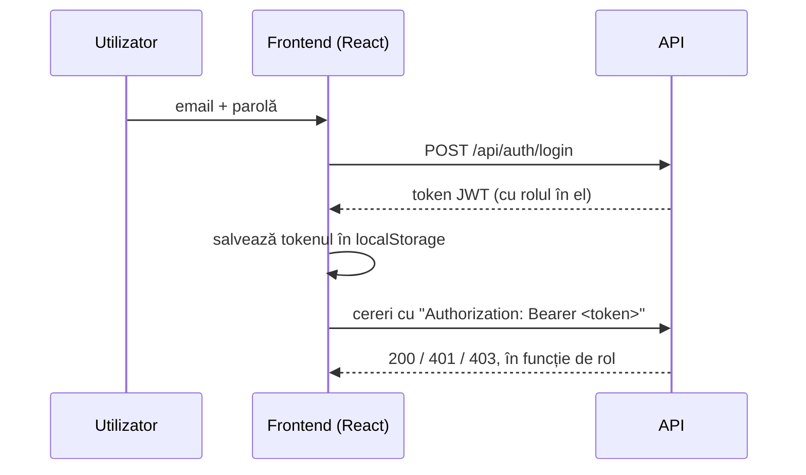

# 🎮 LagStore

**LagStore** este un magazin online de periferice gaming (mouse-uri, tastaturi, căști, monitoare, scaune și altele), realizat pentru materia **Comerț Electronic**.

Acest document descrie ce am construit în **Raportarea I**: catalogul de produse, autentificarea și împărțirea pe roluri.

---

## Ce cerea Raportarea I și cum am rezolvat

| Cerință | Ce am făcut |
|---|---|
| Două roluri: admin și utilizator | Rolurile **Admin** și **Client**, create automat la pornirea aplicației |
| Autentificare ca admin și ca client | Login și înregistrare cu token **JWT**. Contul de admin se creează automat, iar orice cont nou primește rolul Client |
| Adăugare, editare, ștergere de produse | Pagina **Administrare produse**, disponibilă doar adminului, cu tabel, formular și confirmare la ștergere |
| Produsul are nume, descriere, specificații, preț, stoc, furnizor, livrare, categorie | Entitatea `Product`, legată de `Category`, `Supplier` și `DeliveryMethod` |
| Răsfoire produse și categorii | Pagina principală cu filtrare pe categorii, căutare după nume și o pagină de detalii pentru fiecare produs |

---

## Tehnologii folosite

| Parte | Tehnologie |
|---|---|
| Backend | ASP.NET Core Web API (.NET 10) |
| Bază de date | SQL Server LocalDB, prin Entity Framework Core (code-first, cu migrări) |
| Autentificare | ASP.NET Core Identity + JWT Bearer |
| Frontend | React 19 + TypeScript, construit cu Vite |
| Comunicare | Axios, cu interceptori pentru token |
| Documentare API | Swagger (`/swagger`) |

---

## Structura proiectului

```
LagStore/
├── backend/              API-ul ASP.NET Core
│   ├── Models/           Entitățile din baza de date
│   ├── DTOs/             Obiectele trimise și primite prin API
│   ├── Controllers/      Endpoint-urile REST
│   ├── Services/         Generarea tokenului JWT
│   ├── Data/             AppDbContext (EF Core + Identity)
│   └── Migrations/       Istoricul schemei bazei de date
├── frontend/             Aplicația React
│   └── src/
│       ├── api/          Clientul Axios
│       ├── context/      Starea de autentificare (AuthContext)
│       ├── components/   Navbar, ProductCard, ProtectedRoute
│       ├── pages/        Paginile aplicației
│       └── types/        Tipurile TypeScript
└── scripts/
    └── seed.mjs          Populează catalogul cu date de test
```

---

## Modelul de date



- Fiecare produs aparține **unei** categorii, **unui** furnizor și **unei** metode de livrare.
- Prețurile sunt stocate ca `decimal(18,2)`, ca să nu apară erori de rotunjire.
- Utilizatorii sunt gestionați de **ASP.NET Core Identity** (`ApplicationUser`, extins cu `FullName`), în aceeași bază de date.

---

## API-ul

Toate rutele încep cu `/api`.

### Catalog

| Resursă | Citire (oricine) | Scriere (doar Admin) |
|---|---|---|
| `/products` | `GET` listă, `GET /{id}` | `POST`, `PUT /{id}`, `DELETE /{id}` |
| `/categories` | `GET` listă, `GET /{id}` | `POST`, `PUT /{id}`, `DELETE /{id}` |
| `/suppliers` | `GET` listă, `GET /{id}` | `POST`, `PUT /{id}`, `DELETE /{id}` |
| `/deliverymethods` | `GET` listă, `GET /{id}` | `POST`, `PUT /{id}`, `DELETE /{id}` |

Lista de produse acceptă filtre opționale: `GET /api/products?categoryId=3&search=logitech`.

### Autentificare

| Rută | Ce face |
|---|---|
| `POST /auth/register` | Creează un cont nou, cu rolul **Client**, și întoarce un token |
| `POST /auth/login` | Verifică emailul și parola și întoarce un token |

### Reguli pe care le respectă API-ul

- **DTO-uri peste tot.** Controllerele nu expun entitățile direct. DTO-urile de scriere nu conțin `Id`, deci clientul nu poate alege singur id-ul.
- **Validare.** Numele e obligatoriu, prețul trebuie să fie pozitiv, stocul nu poate fi negativ. La cereri invalide API-ul răspunde cu `400`.
- **Referințe verificate.** Un produs nu poate fi salvat cu o categorie, un furnizor sau o metodă de livrare care nu există (răspuns `400`).
- **Fără ștergeri accidentale.** O categorie, un furnizor sau o metodă de livrare folosite de produse nu pot fi șterse (răspuns `409 Conflict`).
- **Coduri HTTP corecte:** `201` la creare, `204` la editare și ștergere, `404` când resursa nu există, `401` fără autentificare, `403` fără drepturi.

---

## Autentificare și roluri



- **Rolul nu vine niciodată din request.** Serverul atribuie rolul `Client` la înregistrare, deci nimeni nu își poate face singur cont de admin.
- **Contul de admin** (`admin@lagstore.ro`) e creat automat la prima pornire, dacă nu există deja.
- **Tokenul expiră după 30 de minute.** După expirare, frontend-ul șterge sesiunea și te trimite la login.
- Tokenul conține id-ul, emailul, numele și rolul utilizatorului, semnate cu HMAC-SHA256.

---

## Frontend-ul

| Pagină | Rută | Cine are acces |
|---|---|---|
| Catalog produse | `/` | Oricine |
| Detalii produs | `/products/:id` | Oricine |
| Autentificare | `/login` | Oricine |
| Înregistrare | `/register` | Oricine |
| Administrare produse | `/admin/products` | Doar Admin |

Pe scurt, ce face fiecare parte:

- **Catalogul** afișează produsele în carduri. Le poți filtra cu chip-uri de categorie și căuta după nume; căutarea pornește la 400 ms după ce te oprești din tastat.
- **Pagina de detalii** arată descrierea, specificațiile tehnice, furnizorul, metoda de livrare (cost și număr de zile) și stocul.
- **Pagina de administrare** are un tabel cu toate produsele și un formular modal pentru adăugare și editare. Categoria, furnizorul și metoda de livrare se aleg din dropdown-uri, iar ștergerea cere confirmare.
- **`ProtectedRoute`** blochează pagina de admin pentru vizitatori și clienți, iar **Navbar-ul** arată linkul de administrare doar adminului.
- **Interceptorii Axios** atașează automat tokenul la fiecare cerere și deconectează utilizatorul când tokenul nu mai e valid.
- Formularele sunt validate și în browser, înainte de trimitere, iar mesajele de eroare sunt în română.

---

## Date de test

Scriptul [`scripts/seed.mjs`](scripts/seed.mjs) populează catalogul **prin API**, autentificat ca admin. Trece astfel prin aceleași validări ca orice alt client al API-ului. Scriptul adaugă:

- **8 categorii:** mouse-uri, tastaturi, căști, monitoare, mousepad-uri, scaune gaming, controllere, microfoane și webcam-uri
- **8 furnizori:** Logitech, Razer, SteelSeries, Corsair, HyperX, ASUS ROG, Samsung, Arozzi
- **5 metode de livrare:** de la ridicare gratuită din magazin până la livrare voluminoasă
- **46 de produse**, fiecare cu descriere și specificații reale

Poți rula scriptul de mai multe ori fără probleme: ce există deja e sărit.

---

## Securitate și configurare

Cheia de semnare JWT și parola contului de admin **nu sunt salvate în repository**. Pe mediul de dezvoltare stau în **.NET User Secrets**, un fișier local din profilul fiecărui utilizator, în afara proiectului:

```bash
cd backend
dotnet user-secrets set "Jwt:Key" "<o cheie lungă și aleatorie, minim 32 de caractere>"
dotnet user-secrets set "SeedAdmin:Password" "<parola adminului>"
```

Dacă una dintre ele lipsește, aplicația se oprește la pornire cu un mesaj care spune exact ce trebuie setat. În `appsettings.json` rămân doar setările care nu sunt secrete: emitentul și audiența tokenului, durata de expirare, emailul adminului și conexiunea la baza de date.
